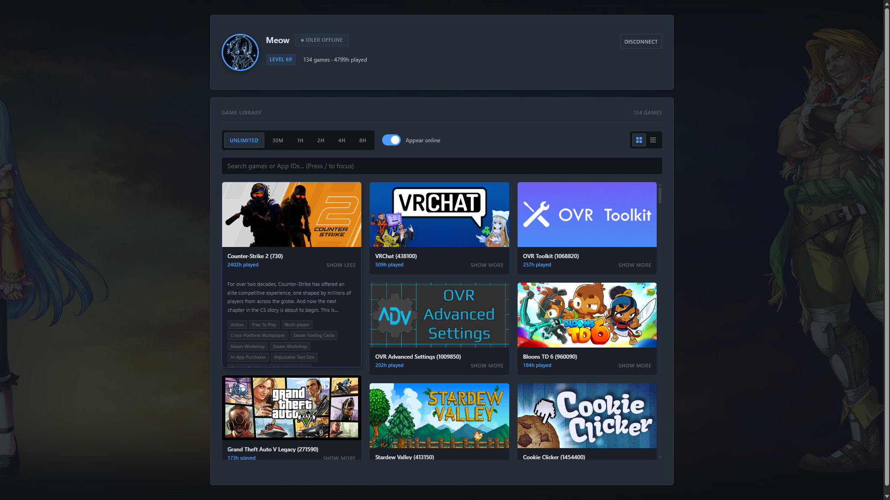
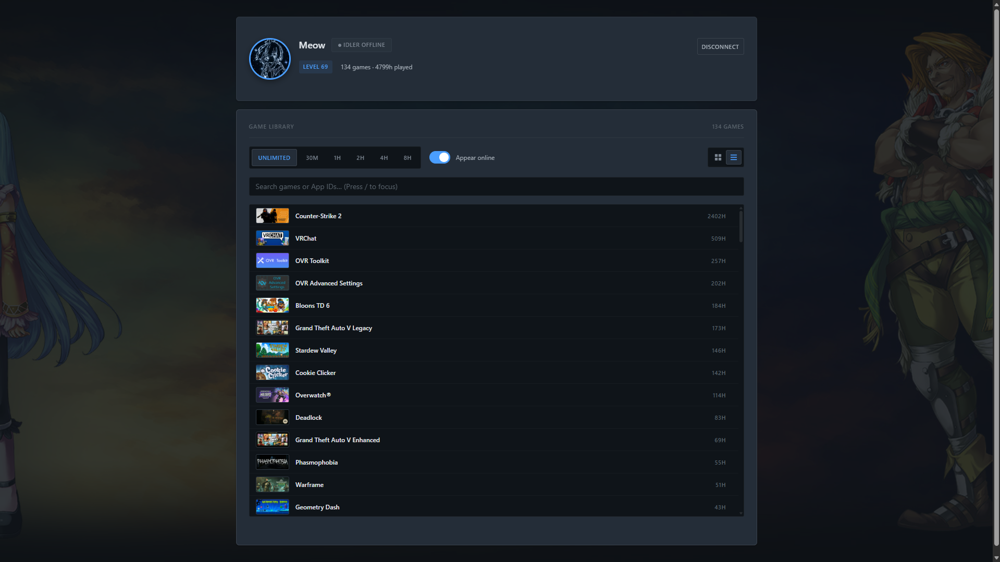
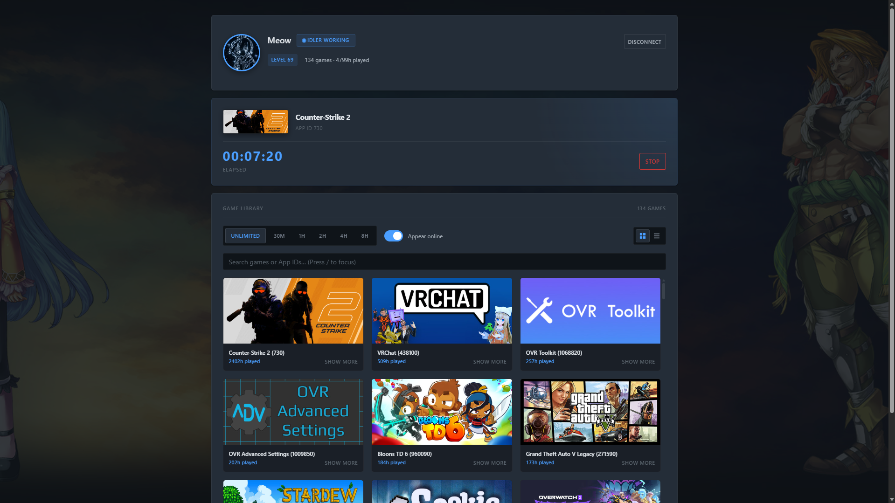
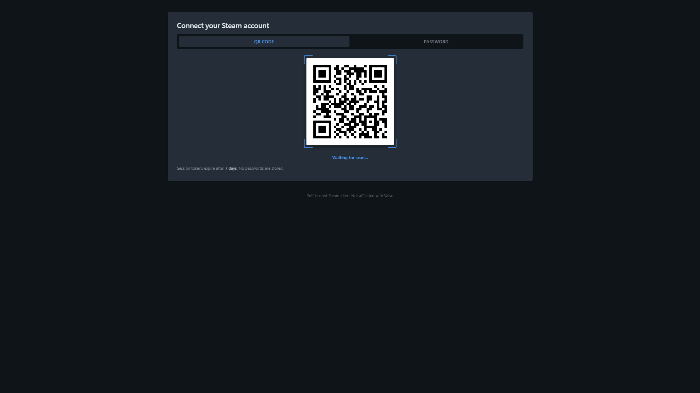

# Steam Idler

A small, self-hosted web panel that farms Steam hours. Sign in with
the Steam Mobile app (QR) or with your account name and password, pick games
from your library, and let the server report them as running. Host it on a vps or in a homelab.

Built with Node.js 22, Express 5, and the [`steam-user`](https://www.npmjs.com/package/steam-user)
and [`steam-session`](https://www.npmjs.com/package/steam-session) packages. The
frontend is plain HTML, CSS, and ES modules — no build step.

> [!IMPORTANT]
> **Unofficial project.** Not affiliated with Valve. Use it with your own
> account, at your own risk. Automating playtime may violate Steam's terms.

## Features

- QR login through the Steam Mobile app, or password login with Steam Guard
- Refresh tokens encrypted at rest with AES-256-GCM
- One active session per Steam account; a new login replaces the old one
- Duration presets from 30 minutes to 8 hours, plus unlimited
- Online/offline persona toggle while idling
- Searchable game library in grid or virtualised list view
- Optional profile background, avatar, level, and VAC badges
- Sessions resume automatically after a server restart
- Same-origin API guard, rate limiting, CSP, strict cookies, and quiet logging
- Debounced, atomic JSON persistence — no database required

## Screenshots

### Dashboard



### List view



### Idling



### Sign in



## Requirements

- Node.js **22.9 or newer** (or Docker)
- A Steam account
- A [Steam Web API key](https://steamcommunity.com/dev/apikey) for the dashboard
  (profile data and the game library)

## Quick start

```bash
git clone <your-fork-url> steam-idler
cd steam-idler
npm ci
cp .env.example .env
```

Fill in `.env`:

```bash
node -e "console.log(require('crypto').randomBytes(32).toString('hex'))"
```

Use the generated value for `SESSION_ENC_KEY` and generate a second value for
`COOKIE_SECRET`. Then start the app:

```bash
npm start
# open http://localhost:3000
```

For development with automatic restarts:

```bash
npm run dev
```

## Docker

```bash
cp .env.example .env   # fill in the values
docker compose up -d --build
```

The app listens on port `8080` and stores its JSON files in `./data`. The
Compose file runs without a reverse proxy, so it sets `TRUST_PROXY=0`. If you
put nginx, Caddy, or Cloudflare in front, set `TRUST_PROXY` to the number of
proxy hops instead.

Compose sets `NODE_ENV=production`, which enables secure cookies by default. If
you open the panel over plain HTTP on a LAN address (for example
`http://192.168.1.10:8080`), add these to `.env` before starting:

```bash
COOKIE_SECURE=false
UPGRADE_INSECURE_REQUESTS=false
```

Use that only on a trusted network. For anything reachable beyond your LAN,
terminate TLS at a reverse proxy and leave both settings enabled.

## Configuration

All variables are read once at startup. Invalid values stop the process with a
clear error rather than failing later at runtime.

| Variable | Default | Description |
|---|---|---|
| `PORT` | `3000` | HTTP listen port |
| `HOST` | `0.0.0.0` | HTTP listen address |
| `NODE_ENV` | `development` | `development`, `production`, or `test` |
| `COOKIE_SECURE` | `true` in production | Send cookies only over HTTPS; disable only for plain-HTTP LAN use |
| `UPGRADE_INSECURE_REQUESTS` | `true` in production with secure cookies | Add the CSP `upgrade-insecure-requests` directive; disable for LAN HTTP |
| `TRUST_PROXY` | `0` | Number of reverse-proxy hops in front of the app |
| `SESSION_ENC_KEY` | — | **Required.** 64 hex chars (32 bytes) for AES-256-GCM |
| `COOKIE_SECRET` | — | **Required.** Random string used to sign cookies (32+ chars in production) |
| `STEAM_API_KEY` | — | Steam Web API key used by the dashboard |
| `DATA_DIR` | `./data` | Directory for `sessions.json` and `machineTokens.json` |
| `STEAM_API_TIMEOUT_MS` | `10000` | Timeout for Steam API requests |
| `LOG_LEVEL` | `debug` in dev, `info` in production | `error`, `warn`, `info`, or `debug` |

`TRUST_PROXY` is security-relevant: if it is too high, clients can spoof
`X-Forwarded-For` and bypass per-IP rate limits. Expose the Node port directly
with `TRUST_PROXY=0`, or set it to the exact number of proxies you run.

## Security

This is a single-operator, self-hosted application. The trusted boundary is the
server process and its data directory. The app is designed for **one trusted
operator** and has no multi-tenant isolation — do not expose it to untrusted
users, and serve it over HTTPS in production.

### What the app protects

- **Refresh tokens at rest.** Steam refresh tokens are encrypted with
  AES-256-GCM using `SESSION_ENC_KEY`. Ciphertexts are versioned (`v1.`) and
  authenticated; tampering fails closed.
- **Session cookies.** Cookies are signed, `HttpOnly`, `SameSite=Strict`, and
  `Secure` when `COOKIE_SECURE` is enabled (the production default). Secure
  cookies use the `__Host-` prefix, which browsers bind to the exact origin.
- **QR login ownership.** The pending login ID lives in a short-lived signed
  cookie scoped to `/api/auth/qr`, so another browser cannot claim someone
  else's pending login.
- **Cross-site requests.** State-changing API calls require a same-origin
  `Origin`/`Referer` and are checked against `Sec-Fetch-Site`.
- **Upstream requests.** Only HTTPS Steam-owned hosts are allowed. Responses are
  size-capped, time-limited, and redirect-limited.
- **Input sanitisation.** App IDs, durations, preference fields, and account
  names are validated and allowlisted before storage.
- **Passwords are never persisted.** They are used once to obtain a refresh
  token.

### What it does not protect

- **Passwords in transit to the server.** Password login sends the password to
  this server, which forwards it to Steam. It is never stored, but the server
  operator can see it in memory. Use QR login if that matters.
- **Compromise of `SESSION_ENC_KEY` or `COOKIE_SECRET`.** Rotating
  `SESSION_ENC_KEY` invalidates stored refresh tokens and forces users to log in
  again. There is no key-rotation UI.
- **Malicious games or Steam responses.** Steam descriptions are treated as
  untrusted text, but profile backgrounds and media URLs are fetched from Steam
  CDNs by the browser.

### Deployment checklist

1. Serve the app over HTTPS. Terminate TLS at a reverse proxy you control.
2. Set `NODE_ENV=production`. Keep `COOKIE_SECURE` and
   `UPGRADE_INSECURE_REQUESTS` enabled; only disable them for a trusted,
   plain-HTTP LAN.
3. Set `TRUST_PROXY` to the exact number of proxies in front of the app. Never
   leave it higher than necessary.
4. Generate unique values for `SESSION_ENC_KEY` and `COOKIE_SECRET`. Keep `.env`
   out of version control and restrict permissions (`chmod 600 .env`).
5. Restrict access at the network layer (VPN, firewall, or proxy auth) unless
   you intentionally want a public login page.
6. Keep `data/` private. It contains encrypted tokens and Steam account names.
7. Run the container as a non-root user. The provided image already does.
8. Update dependencies regularly.
9. Back up `data/` only if you are comfortable storing encrypted refresh
   tokens; otherwise expect to log in again after a rebuild.

### Reporting a security issue

Please **do not open a public issue** for a security problem. Use GitHub's
private vulnerability reporting on the repository (Security → Report a
vulnerability) or contact the maintainer directly. Include a short description,
steps to reproduce, the affected version or commit, and any relevant logs with
secrets removed. You can expect an initial response within a few days; please
give the maintainer a reasonable window to ship a fix before publishing details.

## Testing

```bash
npm run check   # syntax + repository hygiene checks
npm test        # Node's built-in test runner
```

The tests cover token encryption, session lifecycle and resume handling,
configuration validation, the idle-request parse, the two-source game library,
the frontend idle projection, preference sanitisation, profile caching, atomic
persistence, the TTL/LRU cache, and HTTP-level checks for headers (including
CSP), same-origin enforcement, input validation, and the authenticated idle
start/status/prefs path. The HTTP suite injects a fake `steam-user` client
through `createApp`, so no test connects to Steam; each suite sets a temporary
`DATA_DIR` and fixed secrets before requiring the store.

`npm run check` syntax-checks every JavaScript file, resolves every relative
browser import, and rejects external font references and missing required files.

## Project layout

```text
src/
  app.js              Express app assembly (headers, static files, routes)
  server.js           Bootstrap, session resume, graceful shutdown
  config.js           Environment validation and runtime limits
  auth/               QR and password/Steam Guard flows
  db/store.js         Debounced atomic JSON store + profile cache
  lib/                Logger, crypto, HTTP client, TTL cache, idle-request
                      parsing, HTTP error contract
  middleware/         Session cookies, origin guard, error mapping
  routes/             Route factories for auth, idle, prefs, profile, details
  steam/              Steam API, game library, session game list, idle manager
public/               Static frontend (HTML, CSS, ES modules)
test/                 Node test-runner suites
docs/screenshots/     Images used by this README
```

## Architecture

### Request flow

1. **Static assets** are served from `public/` by Express. HTML is sent with
   `Cache-Control: no-cache`; CSS and JS are cached for an hour in production.
2. **API requests** pass through `noStore`, a per-IP rate limiter, and
   `sameOriginGuard`. State-changing requests must come from the same origin.
3. **Session middleware** reads the signed session cookie, validates its shape,
   loads the server-side record, and decrypts the refresh token into
   `req.steamSession`. `requireSession` turns a missing session into a 401.
4. **Route factories** receive the idle manager, account issuance, and game
   library from `src/server.js`; handlers parse input once and call those
   adapters, never a module singleton.
5. **Errors** are mapped by `src/middleware/errors.js`: parser failures become
   400/413, `src/lib/clientError.js` maps known outcomes, and unknown errors are
   logged and returned as a generic 500 without echoing their message.

### Data model

Two JSON files live in `DATA_DIR`:

| File | Contents | Lifetime |
|---|---|---|
| `sessions.json` | One record per browser session: Steam ID, encrypted refresh token, account name, login type, idle prefs, last idled apps, expiry | 7 days, replaced on re-login |
| `machineTokens.json` | Steam Guard machine tokens keyed by normalised account name | Until Steam invalidates them |

Profiles, game lists, Steam API responses, and game details use in-memory
TTL/LRU caches. They are deliberately **not** written to disk: they are large,
private, and cheap to refetch.

`src/db/store.js` marks documents dirty and coalesces writes over a 100 ms
window. Writes are serialised through a promise chain and use write-to-temp +
rename, so a crash cannot leave a half-written JSON file. `store.flush()` is
called during shutdown and in tests. Records are sanitised on load and on write:
proto-polluting keys are dropped, expired sessions are pruned, duplicate Steam
IDs collapse to the newest record, and the number of stored sessions is capped.

### Idle lifecycle

`src/steam/idleSessions.js` owns one `steam-user` client per Steam ID:

- `start()` logs in with the refresh token, calls `gamesPlayed()`, sets the
  persona, and starts a heartbeat plus an optional auto-stop timer.
- Repeating `start()` for a connected account updates the app list instead of
  opening a second connection.
- A disconnect triggers exponential-backoff reconnects (three attempts). A
  `LoggedInElsewhere` result drops the session and clears the stored login.
- `resumeAll()` runs at boot with bounded concurrency. A revoked token for one
  account is logged and skipped; it never crashes startup. Sessions whose
  `stopAt` already passed are cleared instead of resuming as unlimited idling,
  and resumed sessions keep their auto-stop/disconnect callbacks.
- `shutdownAll()` removes listeners and logs clients off before the store is
  flushed.
- `status()` reports whether the client is idling and, after an involuntary
  stop, why (`playingElsewhere` or `autoStopped`) so the UI does not have to
  remember the previous state.

### Game library

`src/steam/library.js` answers "which games does this account own" once. It
prefers the Web API (playtime, free-to-play flags, totals) and falls back to the
active Steam session (names only). Both sources are normalised to one shape;
`hours: null` and `source: "session"` mean unknown playtime, not zero, so the
cards and profile header can say so explicitly.

### Frontend

The frontend is dependency-free and has no build step:

- `public/js/app.js` is the composition root. It checks the session, loads the
  dashboard, starts polling, and wires auth, profile, library, idle, status, and
  theme modules.
- `public/js/auth.js` coordinates the login tabs. QR challenge generation and
  polling live in `auth-qr.js`; password and Steam Guard handling live in
  `auth-password.js`.
- `public/js/library.js` is the library controller for search, view mode, and
  active-game state. Card markup lives in `library-cards.js`, masonry math in
  `library-layout.js`, and Steam details fetching in `library-details.js`.
  Descriptions from Steam are parsed with an inert `DOMParser`; untrusted HTML
  is never assigned to a live element.
- `public/js/idle.js` owns the timer ticker and DOM wiring; the pure
  `public/js/idle-view.js` projects the status payload into one view model.
  `public/js/status.js` maps idler states to the status pill, and
  `public/js/theme.js` applies profile backgrounds and pauses background video.
- `public/js/dom.js`, `steam-url.js`, and `format.js` hold small shared helpers.
- Polling stops when the tab is hidden and resumes on visibility change.

Heartbeat, auto-stop, reconnect, status shaping and restart resumption all live
in `src/steam/idleSessions.js`; Steam API URL builders live in
`steamApiUrls.js`. Session issuance, including the one-live-session-per-account
rule and the Steam Guard machine-token write, lives in
`src/auth/connectAccount.js`.

## Limitations

- In-memory rate limits and pending logins are per process; do not run multiple
  replicas without external state.
- Steam only allows one active game session per account. Starting the game on
  another device disconnects the idler.
- A Steam API key is required for profile data and the game library. Without it
  the dashboard cannot load your games.
- The session lifetime is fixed at seven days. There is no per-user revocation
  UI beyond disconnecting the current session.
- Logging avoids tokens and passwords, but error messages from Steam may still
  contain account identifiers at `debug` level.
- Idling is not the same as playing: achievements, drops, and anti-cheat
  behaviour depend on the game and on Valve's rules.
- The idler refuses to start when another Steam client is already playing a
  game on the same account, and stops automatically if you start playing
  elsewhere. It never force-kicks an active session.

## Contributing

This project is intentionally small and dependency light; please keep changes
focused.

```bash
npm ci
cp .env.example .env
npm run check
npm test
npm run dev
```

You need Node.js 22.9 or newer. A Steam account is only required for manual
end-to-end testing.

- CommonJS in `src/`, `test/`, and `scripts/`; native ES modules in `public/js/`.
- Two-space indentation, single quotes, semicolons, trailing commas in
  multi-line literals. No formatter is enforced; match the surrounding file.
- Keep user-facing errors short and free of secrets or stack traces.
- Prefer the helpers in `src/lib/` over new dependencies. New runtime
  dependencies need a clear justification.
- Browser code must not use `innerHTML` with untrusted data. Use `textContent`
  and DOM construction, or the inert `DOMParser` pattern in
  `public/js/library-details.js`.
- Add or update tests in `test/` for behaviour changes. Tests must not contact
  Steam; use the existing fakes and clock injection where possible.
- In pull requests, describe the problem and the approach, call out
  security-relevant changes explicitly, and keep unrelated refactors out. Update
  this README when behaviour or structure changes.

## License

[ISC](LICENSE)
